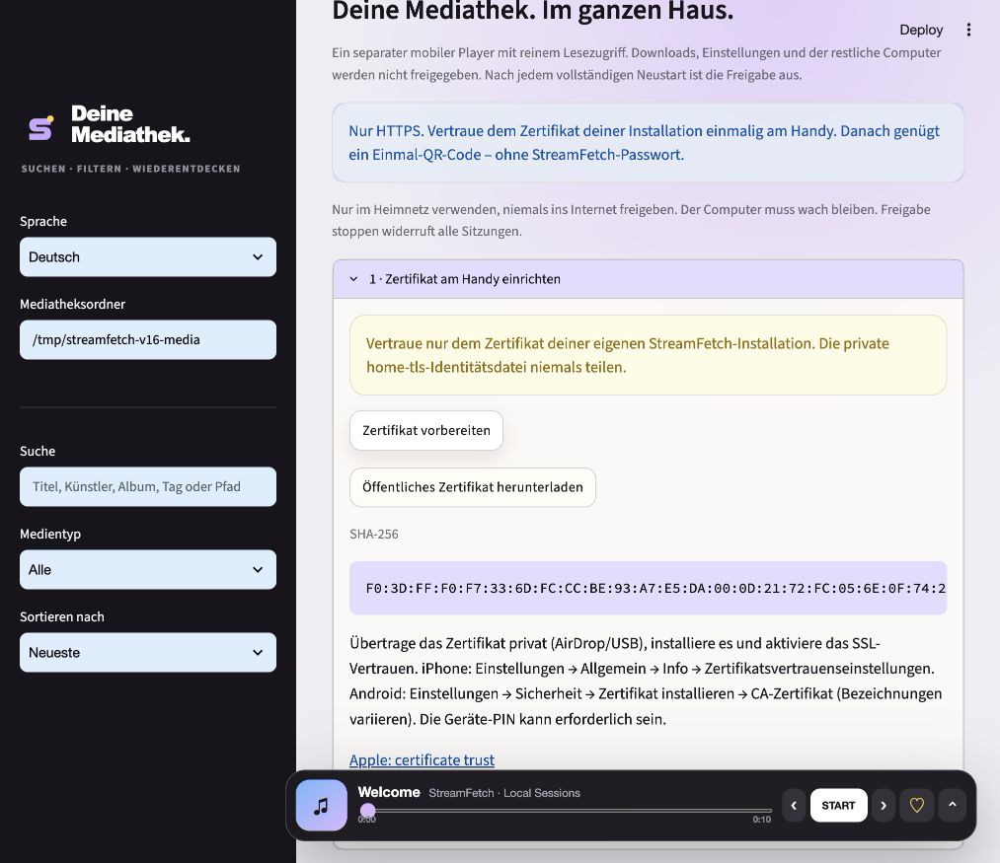
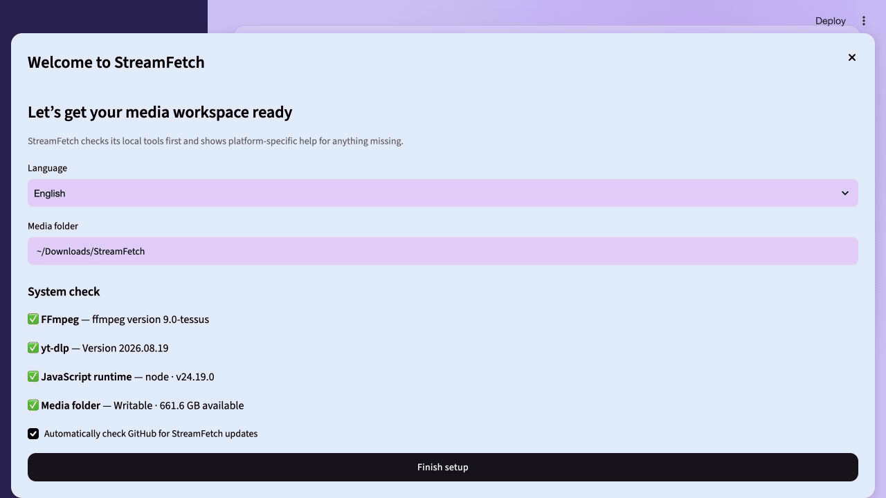
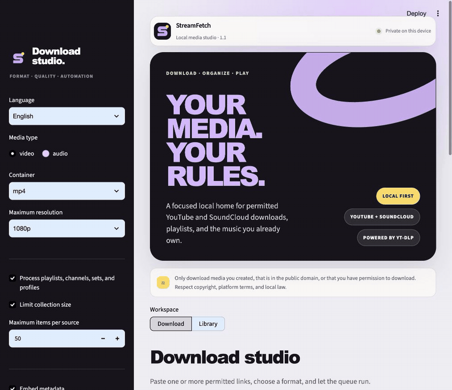
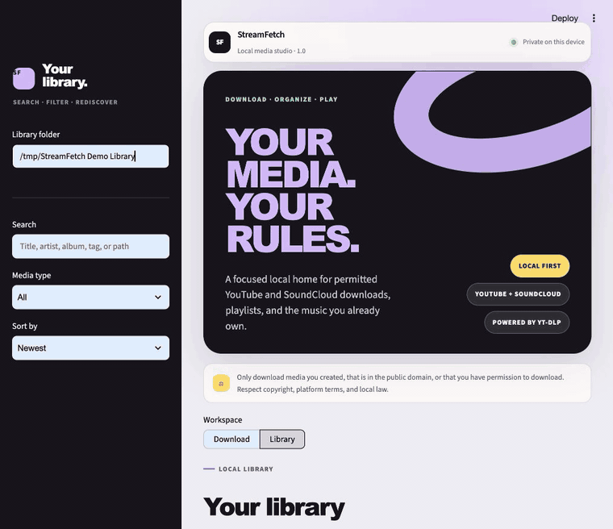

# Changelog

Every StreamFetch release is documented with the same visual format: a short
summary, an authentic product image, user-visible changes, upgrade notes, and
verification details. Full visual notes live in [`docs/releases`](docs/releases).

## [1.7.0] — Scan. Connect. Listen securely.

_Released 2026-10-22 · [Full visual release notes](docs/releases/v1.7.0.md)_

### Highlights

- HTTPS-only home player with persistent installation-local certificates.
- Passwordless one-use QR pairing, two-minute expiry and replay protection.
- Secure twelve-hour sessions; stopping sharing disconnects every device.
- Certificate download, SHA-256 verification and explicit phone trust instructions.
- No automatic trust-store changes, no plaintext fallback, no media migration.
- Real TLS/authentication/streaming tests and updated security documentation.

## [1.6.1] — Clean desktop shutdown

_Released 2026-10-22 · [Full visual release notes](docs/releases/v1.6.1.md)_

### Fixed

- Close the launcher's owned server process group on macOS/Linux, including
  native speech helpers that otherwise survive their main process.
- Target only the owned server process tree on Windows, using the system executable.
- Cover graceful and forced helper cleanup with unit and real process-tree tests.
- No UI changes or data migration; all 1.6 features remain included.

## [1.6.0] — Your library, elevated

_Released 2026-10-22 · [Full visual release notes](docs/releases/v1.6.0.md)_

  

### Highlights

- **1.4 — Smart Library & Listening:** live smart playlists, in-place folder watching,
  bookmarks, chapter jumps, speed, sleep timer and real-file tags with original backups.
- **1.5 — Local Speech Search:** optional on-device transcription, background jobs,
  SRT/VTT import, timestamped phrase search, player jumps and SRT/text export.
- **1.6 — Listen Everywhere at Home:** opt-in, read-only mobile player with pairing,
  playlists, search, byte-range streaming and expiring sessions on trusted home Wi-Fi.
- Added watched libraries to update backups and kept existing media and collections intact.
- Fixed concurrent queue-index creation, frozen multiprocessing helper dispatch,
  compatible audio dependencies and same-origin form authentication.
- Updated README, security documentation and authentic desktop/mobile visuals.

### Quality

- Local suite: 126 passed, one optional FFprobe integration skipped; 80% measured coverage.
- Automated service, persistence, metadata, UI, authentication and streaming tests.
- Actual local model transcription, real multi-format tagging/cover writing and
  original restoration, plus desktop and mobile browser verification.
- Optional FFprobe integration is skipped when FFprobe is not installed.
- Manual interactive Windows startup remains deferred to the user.

## [1.3.0] — Subscriptions & Smart Sync

_Released 2026-10-21 · [Full visual release notes](docs/releases/v1.3.0.md)_

  

### Highlights

- Save YouTube and SoundCloud sources with independent presets, media folders, and limits.
- Discover new arrivals, select the next batch, and track checks and results in persistent sync history.
- Maintain local playlists in source order and retain previous downloads outside the inspection window.
- Enable startup or interval checks while the app is running; downloads remain an explicit action.
- Recover completed jobs after restarts and include subscription data and source libraries in update backups.
- Share download workers across sessions and include dynamically loaded application modules in desktop packages.

### Quality

- 83 automated tests passing with 78% total measured coverage.
- Automated tests cover identity matching, repeated checks, limits, retries, restart recovery, scheduling, playlist order, and backups.
- Real YouTube and SoundCloud source inspections verified; screenshots show the actual application.
- Windows interactive start testing remains a follow-up for the user.

### Repository

- Renamed the GitHub repository to `mxweir/streamfetch` and aligned the description,
  topics, package metadata, documentation links, and updater with the StreamFetch brand.

## [1.2.0] — Daily driver

_Released 2026-10-21 · [Full visual release notes](docs/releases/v1.2.0.md)_

  

### Highlights

- Added a guided first-run flow with local dependency and storage checks plus platform-specific installation help.
- Added GitHub release notifications, optional automatic updates, and a pre-update backup that preserves settings, jobs, and a consistent library snapshot.
- Added cancel controls, scoped partial-file cleanup, automatic retries with backoff, storage estimates, conflict policies, and reusable download presets.
- Added privacy-safe diagnostics and automated macOS, Windows, and Linux desktop release builds.
- Extended the German interface across the new setup, system, update, and job workflows.

### Quality

- 69 automated tests with 82% measured coverage at release time.
- CI verified on Python 3.11, 3.12, and 3.13.
- A native macOS `.app` was built and passed strict code-signing verification.
- Browser QA covered setup, presets, system health, safe update refusal, and the 390 px mobile breakpoint.
- No media migration required; mutable data stays outside the application and is backed up before updating.

## [1.1.0] — Roadmap complete

_Released 2026-10-20 · [Full visual release notes](docs/releases/v1.1.0.md)_

  

### Highlights

- Persisted background jobs across complete app restarts, including safe recovery of interrupted work.
- Added per-item selection for playlists, channels, SoundCloud sets, and profiles.
- Added optional live waveform and spectrum modes to the floating player.
- Added English/German localization, the new StreamFetch logo throughout the app, and a native desktop launcher.
- Added a repeatable PyInstaller profile for platform-specific desktop bundles.

### Quality

- 51 automated tests with 82% measured coverage at release time.
- CI verified on Python 3.11, 3.12, and 3.13.
- Browser QA covered the real collection inspector, both visualizer modes, and live language switching.
- No library migration required; existing local databases remain compatible.

## [1.0.0] — The local media workspace

_Released 2026-10-20 · [Full visual release notes](docs/releases/v1.0.0.md)_

  

### Highlights

- Rebuilt the interface as a premium, responsive desktop-style media app.
- Added a floating player with an expandable, reorderable smart queue.
- Introduced a library home with fresh additions and most-played shelves.
- Consolidated secondary media actions into focused card menus.
- Completed desktop and narrow-screen browser QA.

### Quality

- 40 automated tests with 84% measured coverage at release time.
- CI verified on Python 3.11, 3.12, and 3.13.
- No migration required; existing local library databases remain compatible.

## Earlier releases

| Version | Focus | Release |
| --- | --- | --- |
| 0.9.0 | Local library hub and discovery | [Notes](https://github.com/mxweir/streamfetch/releases/tag/v0.9.0) |
| 0.8.0 | Background download manager | [Notes](https://github.com/mxweir/streamfetch/releases/tag/v0.8.0) |
| 0.7.0 | Smart queue controls | [Notes](https://github.com/mxweir/streamfetch/releases/tag/v0.7.0) |
| 0.6.0 | Continuous queue player | [Notes](https://github.com/mxweir/streamfetch/releases/tag/v0.6.0) |
| 0.5.0 | Persistent player and collections | [Notes](https://github.com/mxweir/streamfetch/releases/tag/v0.5.0) |
| 0.4.0 | Persistent local media library | [Notes](https://github.com/mxweir/streamfetch/releases/tag/v0.4.0) |
| 0.3.0 | Pastel interface redesign | [Notes](https://github.com/mxweir/streamfetch/releases/tag/v0.3.0) |
| 0.2.0 | SoundCloud support | [Notes](https://github.com/mxweir/streamfetch/releases/tag/v0.2.0) |
| 0.1.0 | Initial YouTube downloader | [Notes](https://github.com/mxweir/streamfetch/releases/tag/v0.1.0) |

[1.0.0]: https://github.com/mxweir/streamfetch/releases/tag/v1.0.0
[1.1.0]: https://github.com/mxweir/streamfetch/releases/tag/v1.1.0
[1.2.0]: https://github.com/mxweir/streamfetch/releases/tag/v1.2.0
[1.6.1]: https://github.com/mxweir/streamfetch/releases/tag/v1.6.1
[1.6.0]: https://github.com/mxweir/streamfetch/releases/tag/v1.6.0
[1.3.0]: https://github.com/mxweir/streamfetch/releases/tag/v1.3.0
