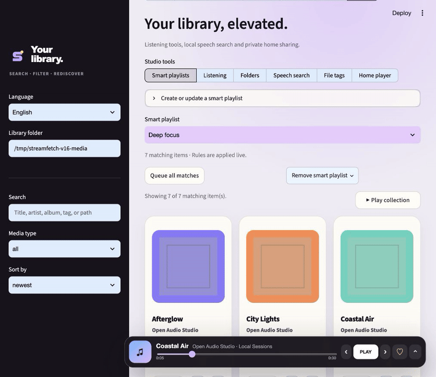
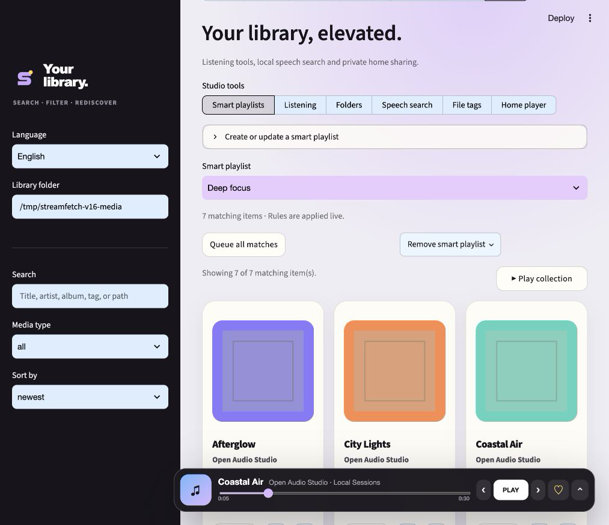
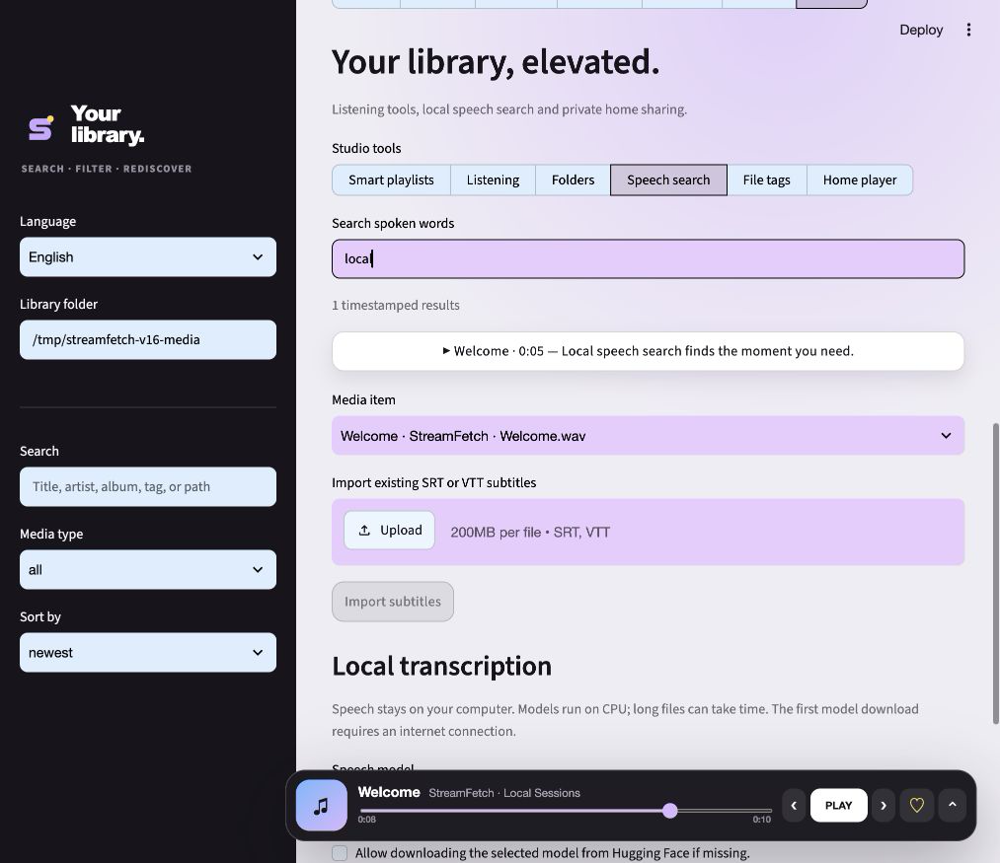
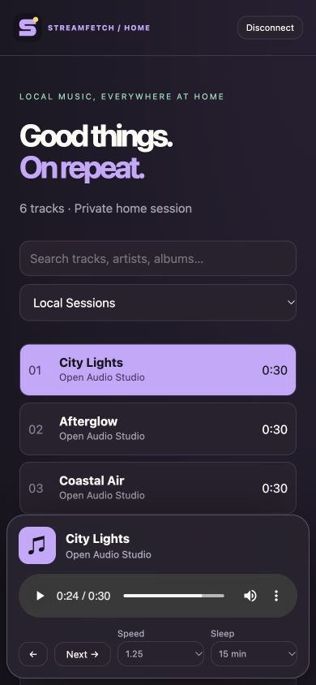

<p align="center">
  
</p>

<h1 align="center">StreamFetch</h1>

<p align="center">
  <strong>Download. Organize. Play.</strong><br>
  A private, local-first media workspace for permitted YouTube and SoundCloud downloads.
</p>

<p align="center">
  <a href="https://github.com/mxweir/streamfetch/actions/workflows/ci.yml"></a>
  <a href="https://github.com/mxweir/streamfetch/releases/latest"></a>
  <a href="https://www.python.org/"></a>
  <a href="LICENSE"></a>
</p>

<p align="center">
  <a href="#quick-start"><strong>Quick start</strong></a> ·
  <a href="#what-you-get"><strong>Features</strong></a> ·
  <a href="CHANGELOG.md"><strong>Changelog</strong></a> ·
  <a href="CONTRIBUTING.md"><strong>Contribute</strong></a>
</p>

<p align="center">
  
</p>

StreamFetch wraps [`yt-dlp`](https://github.com/yt-dlp/yt-dlp) in a focused
Streamlit interface. Download permitted video or audio, keep it in a searchable
local library, and play it without sending your collection to a cloud service.

> [!IMPORTANT]
> Download only media you created, media in the public domain, or media you have
> permission to download. You are responsible for copyright, platform terms,
> and applicable law. StreamFetch does not bypass DRM and is not affiliated with
> YouTube, Google, or SoundCloud.

## Why StreamFetch?

| Local by design | More than a downloader | Built for real collections |
| --- | --- | --- |
| Media, metadata, favorites, playlists, and history stay on your device. | A persistent library and player turn downloads into a usable media workspace. | Search, filters, cover art, editable metadata, duplicate detection, and imports are included. |

## See it in action

<table>
  <tr>
    <td width="50%"></td>
    <td width="50%"></td>
  </tr>
  <tr>
    <td align="center"><strong>A library that keeps up with you</strong><br><sub>Live playlist rules · watched folders · bookmarks · sleep timer</sub></td>
    <td align="center"><strong>Find the moment, not just the file</strong><br><sub>Local transcription · subtitle import · click-to-play search results</sub></td>
  </tr>
</table>

<p align="center">
  
  <br>
  <strong>Your library. Around the house.</strong><br>
  <sub>Opt-in home player · pairing code · mobile playback · no cloud account</sub>
</p>

## What you get

### Smart Library & Listening — 1.4 milestone

- Persistent smart playlists combining tags, ratings, duration, recency, media type and unplayed status
- Watched folders indexed in place every 30 seconds while the app runs; no media copies
- Timestamped bookmarks and embedded chapter navigation with direct playback jumps
- Playback speeds from 0.75× to 2× and a 15/30/60-minute browser sleep timer
- Actual title, artist, album and JPEG/PNG cover writing for MP3, WAV, FLAC, Ogg, Opus and MP4/M4A
- Full original-file backups and explicit restoration; index-only editing remains available

Find these features under **Library → Studio**. Watched folders remain separate
libraries; use **Open library** to switch between them. Sleep timers pause the
current browser player, not the computer, and require the player tab to stay open.

### Local Speech Search — 1.5 milestone

- Optional CPU-based, on-device transcription using faster-whisper (`tiny`, `base`, `small`)
- Background jobs with visible status, cooperative cancellation and retry after interruption
- SRT/WebVTT import, literal phrase search and timestamped results that jump into the player
- Export transcripts as plain text or SRT; changed media is marked outdated and excluded from search

Source installs can enable the optional engine with:

```bash
pip install -e ".[transcription]"
```

Standalone builds include the engine, but no model. The first model download
from Hugging Face requires explicit permission and internet access. Once cached,
transcription works offline. No speech is sent to a transcription service.
Without the engine, subtitle import and search still work. Long recordings can
take time on CPU; cancellation takes effect between decoded segments.

### Listen Everywhere at Home — 1.6 milestone

- Separate, read-only mobile player for the single library you choose to share
- Track/artist/album search, playlists, next/previous, playback speed, resume and sleep timer
- Audio/video streaming with byte-range support for seeking (browser codec support required)
- Random pairing code, HttpOnly/SameSite session cookies, 12-hour expiry and login throttling
- Sharing starts only after confirmation and is off after a full restart

In **Library → Studio → Home player**, start sharing, open the shown address on
a phone connected to the same Wi-Fi, and enter the code from **Show pairing code**.
Keep the computer awake and allow the selected port through its local firewall
if needed. Stop sharing to revoke every connected session.

> [!WARNING]
> The home player uses **unencrypted HTTP** and is intended only for trusted home
> networks. Never forward its port to the internet. The administrative Streamlit
> interface stays on loopback by default. Home-player interface text is currently English.

### Subscriptions & Smart Sync

- Save YouTube channels and playlists or SoundCloud profiles, sets, and playlists
- Set a format preset, media folder, download batch limit, and inspection limit per source
- Preview new items and select what to download; completed items stay out of the next batch
- Recognize existing library items by their source URL and reuse completed subscription media
- Maintain a dedicated local playlist that follows the latest inspected source order
- Check manually, at startup, or at an optional interval while StreamFetch is running
- Keep per-source check history and retryable download results across restarts

Checks only discover new items. Downloads start after you select and confirm
them. Each check inspects up to 500 source entries in the platform's returned
order; older local items outside that window are retained.

### Download studio

- YouTube videos, playlists, channel tabs, and multiple URLs
- SoundCloud tracks, sets, playlists, profiles, and share links
- Video output as MP4, MKV, or WebM; audio as MP3, M4A, Opus, FLAC, or WAV
- Resolution and audio-quality controls, metadata, thumbnails, and subtitles
- Parallel background jobs with live progress, speed, ETA, pause, resume, cancel, and retry
- Automatic retry with backoff, scoped partial-file cleanup, and free-space estimates
- Presets for MP3, lossless audio, 1080p video, and archive quality
- Explicit resume, skip, or overwrite handling when a destination already exists
- Durable job state that survives closing and fully restarting the app
- Per-item preview and selection before downloading playlists, channels, sets, or profiles
- Collection safety limits, bandwidth limits, fragment concurrency, clip ranges,
  chapter splitting, SponsorBlock, and optional browser cookies
- Download archive and cross-platform filename normalization

### Media library

- Rebuildable SQLite index for MP3, M4A, Opus, Ogg, FLAC, WAV, MP4, MKV, and WebM
- Embedded metadata and cover-art extraction with local search, filters, and sorting
- Favorites, custom playlists, history, ratings, tags, and editable display metadata
- Artist and album pages plus recently added, most played, highly rated, and unplayed views
- Recursive folder import and exact duplicate detection with SHA-256 confirmation

### Player

- Floating mini-player that becomes a full-width bottom bar on narrow screens
- Persistent current item, queue, playback position, volume, repeat, and transition settings
- Automatic queue advancement and next-item preloading across audio and video
- Previous/next, seek, shuffle, play-next, clear, remove, and drag-to-reorder controls
- Keyboard shortcuts: <kbd>Space</kbd> play/pause, <kbd>N</kbd> next,
  <kbd>P</kbd> previous, and arrow keys to seek five seconds
- Optional live waveform and audio-spectrum visualizations powered by the Web Audio API

### App experience

- English and German interface with an automatic system-language default
- StreamFetch logo and identity throughout the browser and native desktop shell
- Guided first-run setup and startup checks for FFmpeg, yt-dlp, JavaScript, and storage
- GitHub release notifications and optional backed-up, data-preserving updates
- Privacy-safe diagnostics that omit URLs, cookies, filenames, and absolute media paths
- Native desktop launcher plus automated macOS, Windows, and Linux release builds

## Quick start

### 1. Install system tools

```bash
# macOS
brew install ffmpeg node

# Ubuntu / Debian
sudo apt update && sudo apt install ffmpeg nodejs

# Windows
winget install Gyan.FFmpeg
winget install OpenJS.NodeJS.LTS
```

StreamFetch verifies FFmpeg, yt-dlp, a supported JavaScript runtime, and the
selected media folder during setup. If something is missing, it shows the exact
installation command for the current operating system.

### 2. Install StreamFetch

```bash
git clone https://github.com/mxweir/streamfetch.git
cd streamfetch
python -m venv .venv
source .venv/bin/activate        # Windows: .venv\Scripts\activate
python -m pip install --upgrade pip
pip install -e .
```

### 3. Run it

```bash
streamlit run app.py
```

Open `http://localhost:8501`, paste one permitted URL per line, choose the
format, confirm permission, and start the download. Files are saved to
`~/Downloads/StreamFetch` by default and organized by uploader and collection.

> [!TIP]
> Keep `yt-dlp` current. Some YouTube formats can also require a JavaScript
> runtime supported by yt-dlp.

## Native desktop app

Run StreamFetch in its own native window instead of a browser tab:

```bash
pip install -e ".[desktop]"
streamfetch-desktop
```

To create a standalone desktop build for the current operating system:

```bash
pip install -e ".[package]"
pyinstaller --clean packaging/streamfetch.spec
```

The build is written to `dist/StreamFetch.app` on macOS and to the matching
platform executable on Windows or Linux. Tagged GitHub releases automatically
build a DMG, Windows EXE, and Linux archive. Signing and notarization run when
the repository's optional signing secrets are configured.

## Docker

```bash
docker build -t streamfetch .
docker run --rm -p 127.0.0.1:8501:8501 -v "$PWD/downloads:/app/downloads" streamfetch
```

Browser-cookie extraction is intended for a native local installation. It is
not available in the default container unless a browser profile is explicitly
mounted.

## How local storage works

Selecting **Library** indexes the chosen media directory in
`.streamfetch/library.db`. The database contains the metadata index plus your
collections, listening state and transcripts; preserve it in backups. A refresh notices
added, changed, moved, or missing files. StreamFetch never deletes your media
when cleaning the index or reviewing duplicates.

Standard metadata edits affect only the index. **Studio → File tags** is an
explicit exception: it writes the real file after creating a full backup in
`.streamfetch/tag-backups/<id>/`. Restoring replaces the current file with that
backup. Keep enough free space for both copies and pause playback before editing.
Favorites, playlists, smart rules, bookmarks, transcripts, the queue, paused
positions, and up to 5,000 recent play actions live in the library database.

Download jobs are stored separately in `~/.streamfetch/download-jobs.json`.
Completed and failed jobs return after a restart; interrupted jobs return paused
and can be resumed deliberately.

App preferences, update metadata, and pre-update backups live in
`~/.streamfetch/`. Before any update is installed or staged, StreamFetch creates
a ZIP containing settings, job state, and a consistent SQLite snapshot. Media
files are never copied, replaced, or deleted by the updater. Source checkouts
are only updated automatically when they are clean and currently on `main`.

Subscriptions and sync history live in `~/.streamfetch/subscriptions.db`.
Subscription downloads are stored inside each source's selected media folder
under `Subscriptions/`. Open that folder in Library to play or organize them.
Removing a source keeps its files and local playlist. Update backups include
the subscriptions database and the library index for every source folder.

Watched roots are stored in `~/.streamfetch/watched-folders.json`; their library
databases are also included in pre-update backups. Speech models are cached in
`~/.streamfetch/models/` and are not copied into update ZIPs. Interrupted speech
jobs are marked for manual retry, never silently restarted. Sharing credentials
and sessions exist only in memory and are discarded when sharing stops.

## Updates and diagnostics

The optional startup check reads the latest public GitHub release and caches the
result for six hours. Updates are handled according to the installation type:

- Source checkout: fast-forward `main`, then refresh the desktop dependencies.
- Python package: upgrade from the matching GitHub release tag.
- Standalone desktop build: download the platform artifact and let the operating
  system open it after StreamFetch has staged the backup.

Automatic installation is off by default. Update checks can also be disabled.
The diagnostics ZIP is designed for issue reports and intentionally excludes
download URLs, browser cookies, media filenames, and absolute media paths.

## Development

```bash
pip install -e ".[dev]"
ruff check .
pytest
```

The project supports Python 3.11, 3.12, and 3.13. Downloader option generation
is unit-tested without contacting YouTube or SoundCloud.

Release notes follow a visual, repeatable format. See [CHANGELOG.md](CHANGELOG.md)
for the history and [docs/RELEASING.md](docs/RELEASING.md) for the screenshot and
release checklist.

## Deployment and security

StreamFetch is designed as a trusted, single-user local application. A public
deployment can expose local paths or browser cookies and consume substantial
bandwidth and storage. Do not expose it to the internet without authentication,
quotas, isolation, and storage controls. Please report vulnerabilities through
[SECURITY.md](SECURITY.md).

## Version 1.6: a complete local listening workflow

This release combines the 1.4 listening, 1.5 local search and 1.6 home-player
milestones. Saved sources and selective sync from 1.3 remain included. See the
[visual 1.6 release notes](docs/releases/v1.6.0.md) for authentic screenshots,
upgrade notes and verification details.

The [1.6.1 desktop patch](docs/releases/v1.6.1.md) also cleans up the owned server
and native speech helpers when the desktop window closes. No data migration is needed.

## Contributing

Issues and focused pull requests are welcome. Start with
[CONTRIBUTING.md](CONTRIBUTING.md), check the
[open issues](https://github.com/mxweir/streamfetch/issues), and
keep examples free of private media, browser data, credentials, and personal
paths.

<p align="center">
  <sub>Built with Streamlit, yt-dlp, Mutagen, SQLite, and a local-first mindset.</sub>
</p>
