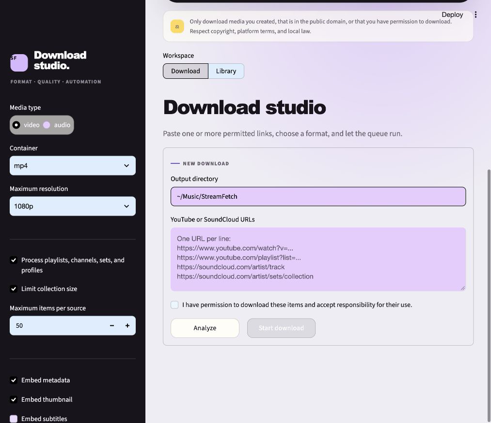
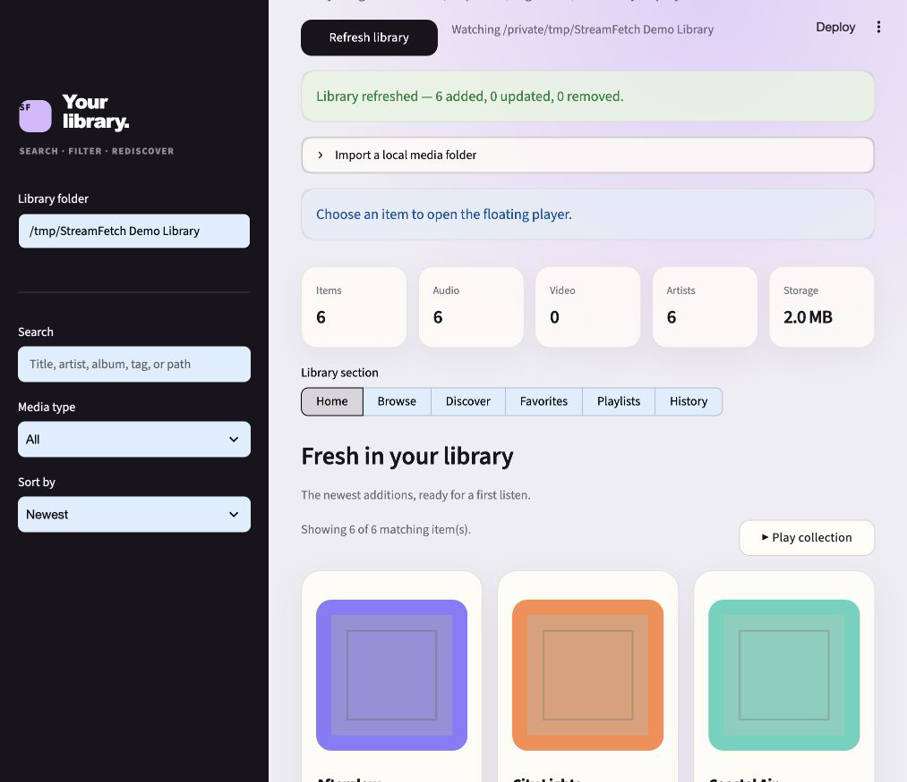
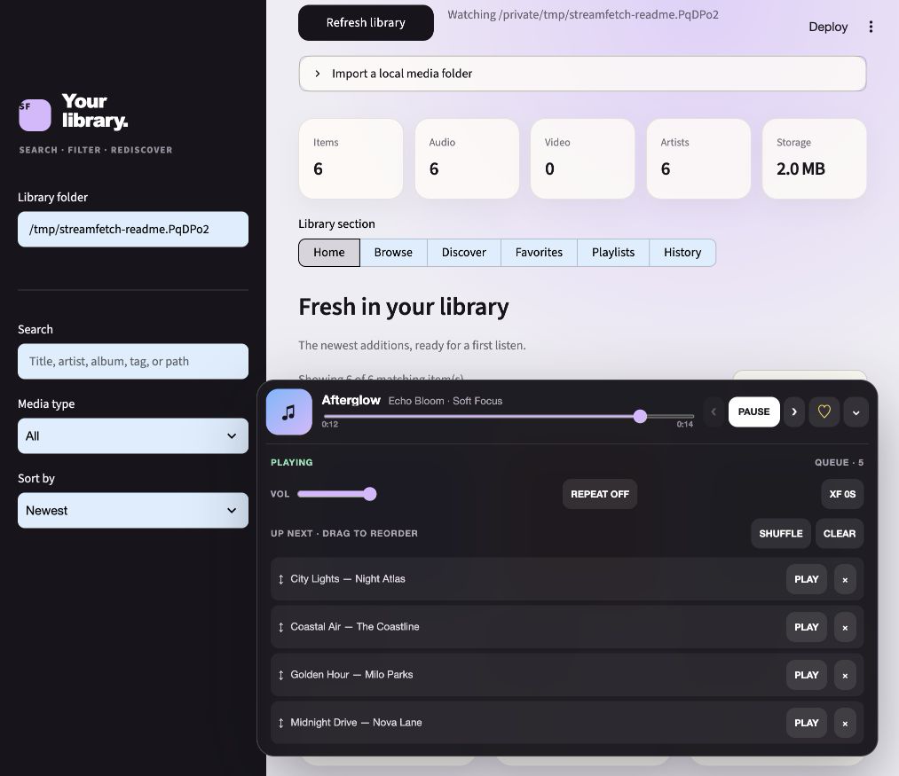

# StreamFetch 1.0.0 — The local media workspace

_Released 2026-10-20 · Stable_

## In one sentence

StreamFetch 1.0 brings downloads, a searchable local collection, and continuous
playback together in one polished, responsive workspace.

## Visual tour

<p align="center">
  
</p>

| Download studio | Local library |
| --- | --- |
|  |  |



## What changed

### Added

- Responsive library home with fresh additions and most-played shelves.
- Floating, expandable media player with a persistent queue.
- Queue reordering, shuffle, repeat, crossfade, play-next, remove, and clear actions.
- Compact card menus for playlists, metadata editing, and file details.

### Improved

- Reworked the entire visual hierarchy around a focused desktop-app shell.
- Simplified media cards so primary playback actions remain prominent.
- Adapted navigation, statistics, and the player for narrow mobile screens.

### Fixed

- Kept the player anchored to the viewport while browsing long collections.
- Prevented repeated media cards from producing duplicate Streamlit widget keys.

## Upgrade notes

No migration is required. Pull the release, reinstall the editable package if
needed, and start Streamlit as usual:

```bash
git pull
pip install -e .
streamlit run app.py
```

Existing `.streamfetch/library.db` databases remain compatible.

## Verified with

- Python 3.11, 3.12, and 3.13 in GitHub Actions
- 40 automated tests and 84% measured coverage at release time
- Desktop browser QA and a 390 × 844 narrow-screen pass

## Links

- [GitHub release](https://github.com/mxweir/streamfetch/releases/tag/v1.0.0)
- [Pull request #20](https://github.com/mxweir/streamfetch/pull/20)
- [Tracking issue #19](https://github.com/mxweir/streamfetch/issues/19)
