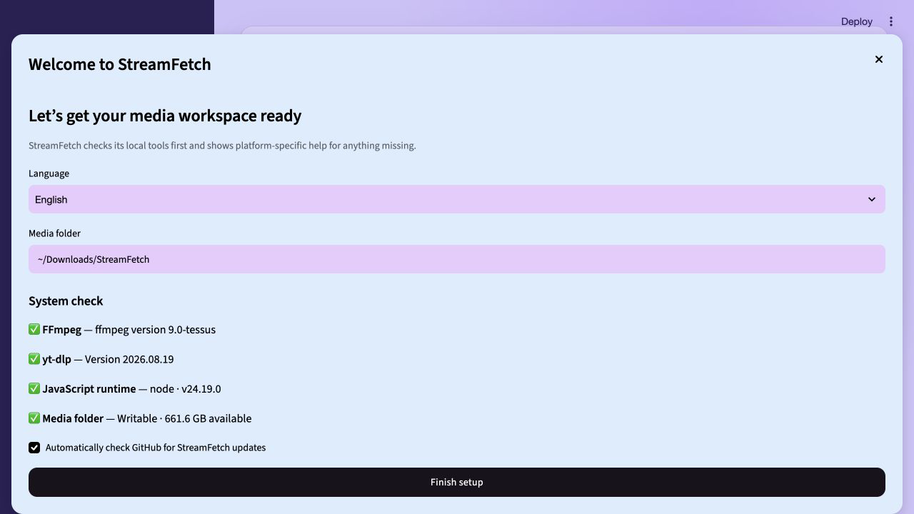
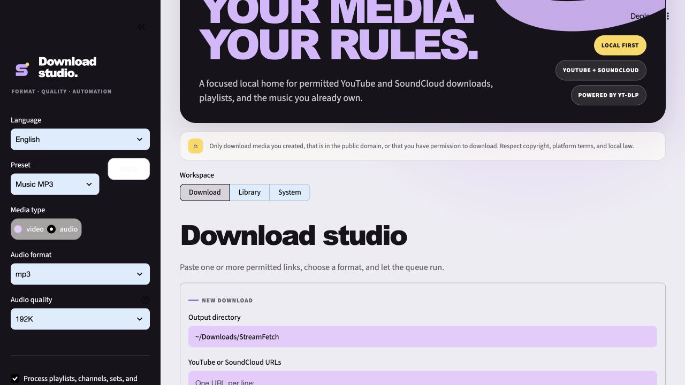
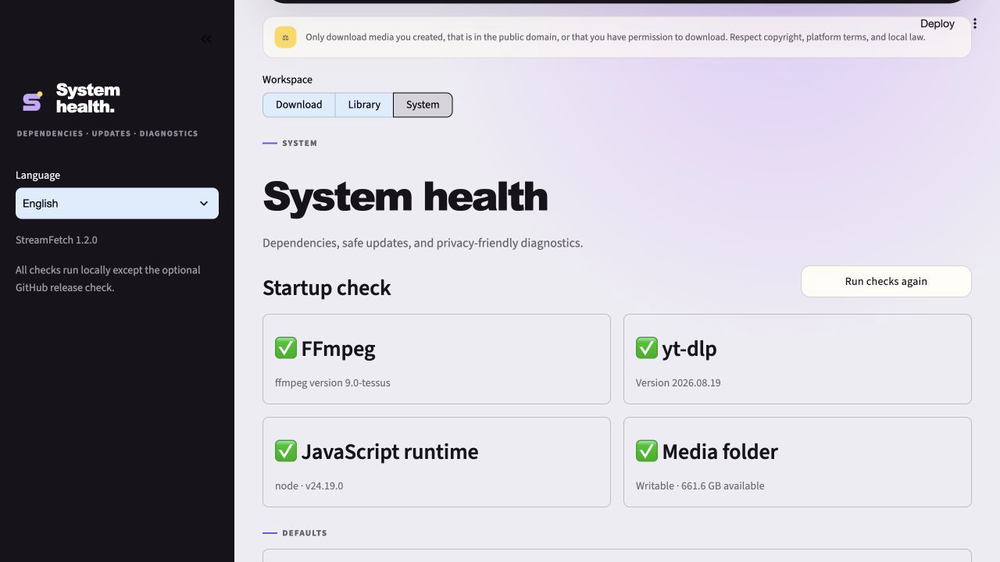

# StreamFetch 1.2.0 — Daily driver

_Released 2026-10-21_

## In one sentence

StreamFetch 1.2 turns the local media workspace into a safer daily-use desktop
application with guided setup, dependency health checks, recoverable updates,
stronger download controls, presets, diagnostics, and cross-platform builds.

## Visual tour

  

| Guided setup | Download presets |
| --- | --- |
|  |  |

## What changed

### Added

- First-run setup with platform-specific dependency guidance.
- Startup health checks for FFmpeg, yt-dlp, a JavaScript runtime, and media storage.
- GitHub release checks plus backed-up, data-preserving updates.
- Safe cancellation, scoped partial-file cleanup, automatic retries, presets,
  storage estimates, conflict policies, and privacy-safe diagnostics.
- Automated macOS, Windows, and Linux desktop release builds.

### Improved

- Extended German localization across setup, system health, updates, imports,
  metadata, duplicates, playlists, history, and job workflows.
- Improved small-screen layout and restored responsive component styling.

### Fixed

- Kept application updates separate from media, library data, settings, and job state.
- Made SQLite backups consistent even while the library is open.
- Prevented retry timers from submitting work after the job manager shuts down.

## Upgrade notes

StreamFetch creates a backup before installing or staging an update. The archive
contains settings, persisted jobs, update metadata, and a consistent SQLite
snapshot of the library index. Media files are never part of the update process.

Automatic installation is disabled by default. Source checkouts must be clean
and on `main`; otherwise StreamFetch leaves the checkout unchanged and explains
why. Standalone builds stage the platform installer for the user to open.

## Verified with

- 69 automated tests passing with 82% measured coverage.
- Ruff, Python bytecode compilation, and embedded player JavaScript syntax checks.
- CI matrix support for Python 3.11, 3.12, and 3.13.
- Native macOS arm64 `.app` build, 93 MB, with strict code-signing verification.
- Browser QA at desktop size and a 390 × 844 mobile viewport.

## Links

- [Tracking issue #25](https://github.com/mxweir/streamfetch/issues/25)
- [GitHub release](https://github.com/mxweir/streamfetch/releases/tag/v1.2.0)
- [Changelog](../../CHANGELOG.md)
