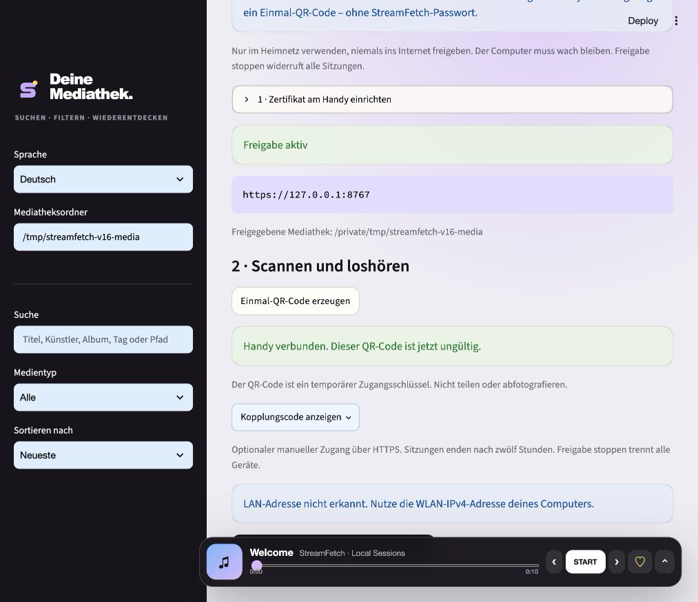

# StreamFetch 1.7.0 — Scan. Connect. Listen securely.

_Released 2026-10-22 · Stable_

## In one sentence

An encrypted home player with short-lived QR pairing: trust your installation's
certificate once, then connect your phone without typing a StreamFetch password.

## Visual tour

Screenshots use synthetic media and a loopback demo address, not a real LAN IP.
No active QR credential or manual pairing secret is published.

## What changed

### Added

- Mandatory TLS 1.2+ for the separate home player; no plaintext fallback.
- Per-installation local CA, public certificate export, SHA-256 fingerprint and
  explicit iPhone/Android trust instructions. No automatic OS trust changes.
- Single-use QR credentials that expire after two minutes. Generating a new code
  invalidates the previous one; redemption is atomic even with simultaneous scans.
- QR credentials use URL fragments, are removed from browser history and are
  redeemed in a TLS-protected POST, never in server GET URLs.
- Secure, HttpOnly, SameSite=Strict cookies; sessions last twelve hours.
- German desktop setup and pairing states, with certificate/QR guidance.

### Improved

- Private-network IPv4 selection, certificate SAN validation and background TLS
  handshakes so a stalled client does not block accepting other connections.
- Certificate identity persists outside the installed app across updates. Public
  exports contain no private keys. Private CA material is excluded from ZIP exports.
- Existing login throttling, read-only scope, range streaming and stop/restart
  revocation apply to the encrypted player too. Manual HTTPS pairing remains optional.

## Upgrade notes

No media/library migration required. Source users reinstall dependencies with
`pip install -e .`; packaged users use the updated desktop distribution.
New runtime dependencies: cryptography and qrcode.

Existing HTTP home-player links no longer work. Transfer the public `.cer` file
privately to your phone, verify its fingerprint and explicitly install/enable
trust. Then start sharing and scan a generated QR code on the same home Wi-Fi.
Your phone may require its unlock PIN during certificate setup. Never bypass
browser certificate warnings. Some managed devices/browser policies forbid
custom CAs. Keep the computer awake and allow only the home-network firewall port.

Protect the private `home-tls/identity.json` file in your application state folder.
It survives upgrades but is intentionally excluded from portable backup ZIPs.
Back it up separately to protected storage. Deleting it requires re-enrolling
phones; corrupt/expired identities fail closed. Remove its trust when retiring it.
See [security boundaries](../../SECURITY.md).

## Verified with

- Local Python 3.12 suite: 142 passed, one optional FFprobe integration skipped;
  80% measured overall coverage. Ruff passes.
- Automated TLS certificate verification, plaintext/untrusted-client rejection,
  QR expiry/rotation/replay/concurrent redemption, secure cookies and range streaming.
- Persisted certificate identity, private file modes, corrupt-state failure and
  private-address validation tests, plus all existing application tests.
- Actual desktop setup/QR UI with neutral media. Phone certificate installation,
  camera scan and mobile OS trust remain manual device checks, not claimed here.
- The actual UI QR image was decoded and redeemed by a local TLS-verifying test
  client, which retrieved seven demo items and a media byte range. The connected
  screenshot shows that test client, not a physical phone.
- Manual Windows interactive startup/close remains deferred; optional FFprobe
  integration is skipped locally when FFprobe is unavailable.

## Links

- [GitHub release](https://github.com/mxweir/streamfetch/releases/tag/v1.7.0)
- [Source and changelog](https://github.com/mxweir/streamfetch)
- [Apple certificate-trust instructions](https://support.apple.com/en-gb/102390)
