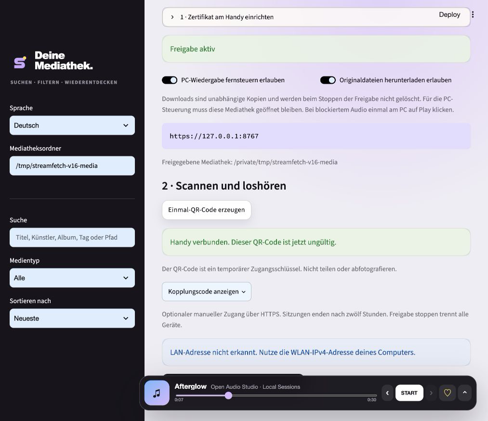
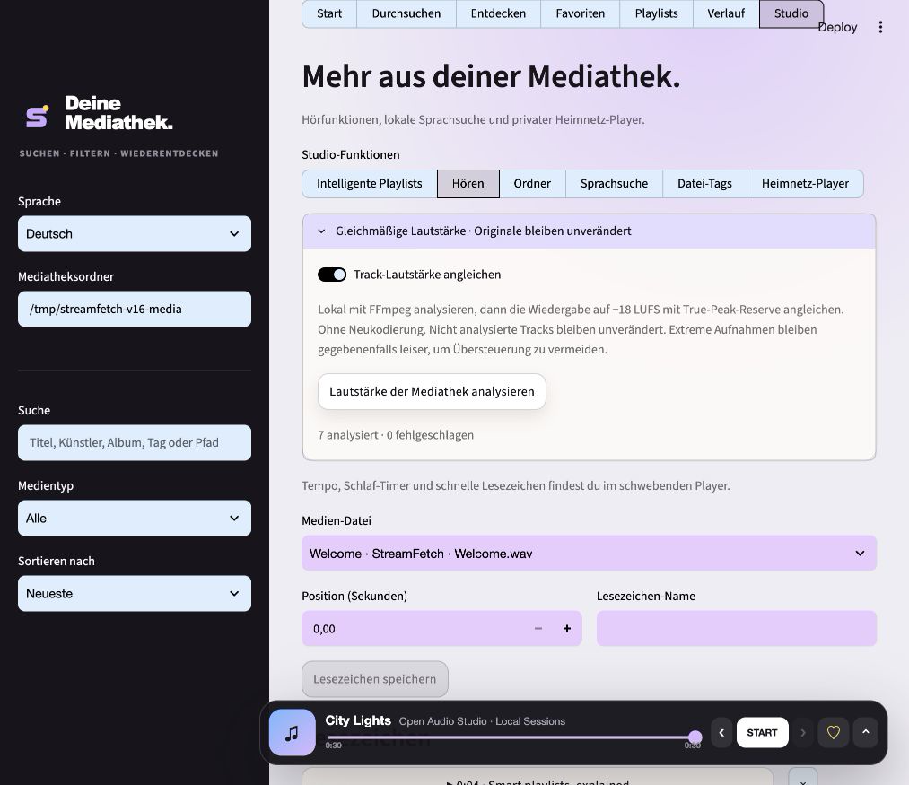
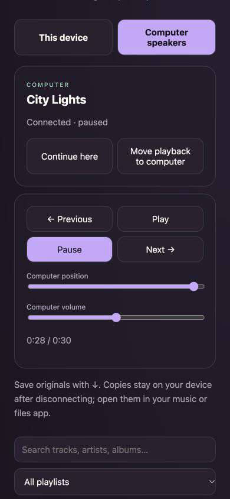

# StreamFetch 1.8.0 — One library. Connected listening.

_Released 2026-10-22 · Stable_

## In one sentence

Move listening between your computer and phone, control computer speakers, match
track loudness and save originals on paired devices—with explicit permissions.

## Visual tour

Desktop images use the real application with synthetic media and a loopback
address. No pairing secret or active QR credential is published.

The mobile image shows the actual HTML/JavaScript at 390 × 844 with a synthetic
API fixture. It is a layout/interaction preview, not evidence of physical-phone
certificate trust or a real PC handoff. The real desktop bridge was independently
verified over strict TLS, as described below.

## What changed

### Added

- **Continue here:** pause the computer, wait for its acknowledgement, then open
  the same track at its confirmed position on your phone.
- **Move playback to computer:** send the track and position to the PC player;
  pause local playback only after the computer confirms it can play.
- **Computer speakers:** separate destination with play/pause, previous/next,
  seeking and player volume. Computer browser/library tab must remain open.
- **Save originals:** authenticated, permission-gated downloads with attachment
  filenames, range support and containment checks. No conversion or cloud upload.
- **Loudness matching:** local FFmpeg EBU R128 measurement; cached, non-destructive
  Web Audio playback gain toward −18 LUFS with measured −1 dBTP headroom and a
  maximum 12 dB boost. Silence is not boosted. Unmeasured files remain unchanged.

### Improved

- Clear “This device” versus “Computer speakers” destination controls, connection
  state and actionable offline/autoplay messages. Empty mobile player stays hidden.
- Independent opt-in computer-control and original-download permissions, both off
  by default. Permissions apply to all paired devices in the current sharing session.
- One desktop-controller lease per library, bounded command queue, command expiry
  and acknowledgement. No OS remote-control or arbitrary command execution.
- Persistent playback positions. Paused desktop heartbeats do not overwrite
  progress from a phone that continued listening.
- Stop/revoke clears pending commands; original copies already saved elsewhere
  cannot be revoked. Source media, metadata and collections remain intact.

## Upgrade notes

No media migration is needed. Loudness measurements use a new optional table in
the existing library database. Existing update backups include that table. TLS
identity and the one-time phone certificate setup from 1.7 remain unchanged.

To enable connected listening, open **Library → Studio → Home player**, explicitly
allow computer playback control, start sharing and pair a device. Keep the
computer's library tab open. Most browsers require a first play click on the
computer; mobile autoplay may require a separate tap after a handoff. A sleeping
computer or closed browser cannot play to speakers. This controls the StreamFetch
player volume, not your operating system's master volume. It is not multi-room
audio synchronisation or a native background music service.
Browser/OS background throttling can also delay controls or expire the desktop lease.

For consistent volume, use **Studio → Listening → Match track loudness**, then
**Analyse library loudness**. FFmpeg is required. Analysis is local and can be
stopped after the current track; changed files require another analysis. Playback
gain is not written into downloaded originals. Peak-limited recordings may remain
quieter rather than clipping. Web Audio must be supported and unlocked by the browser.

Saved originals remain on the receiving device after sharing stops. Open them in
the device's music/files app for offline listening; the web interface itself is
not an offline PWA. Browser codec support and local copyright permissions apply.

## Verified with

- Local Python 3.12: 162 passed, one optional FFprobe integration skipped. Ruff passes.
- Automated tests cover controller leases, acknowledgements, blocked autoplay,
  expiry, bounded commands, invalid controls, permission gates and progress storage.
- Actual desktop browser controlled by a strict certificate-verifying TLS client:
  pause, seek, volume, track/position transfer, confirmed play and pause. The
  original-file download matched its source byte-for-byte.
- Actual FFmpeg analysis and unchanged-source checks; cache reuse/invalidation,
  silence, target gain and peak-headroom tests. Seven real demo files analysed.
- Narrow mobile layout/interaction testing uses an explicitly labelled isolated
  synthetic UI fixture, not a bypass of HTTPS certificate checks. Real phone trust,
  camera pairing, Safari/Android audio behaviour and downloads remain device checks.
- Optional FFprobe integration skips locally when unavailable. Manual Windows
  interactive testing remains deferred; desktop packages are built in release CI.

## Links

- [GitHub release](https://github.com/mxweir/streamfetch/releases/tag/v1.8.0)
- [Security boundaries](../../SECURITY.md)
- [FFmpeg loudness filter](https://ffmpeg.org/ffmpeg-filters.html#loudnorm)
