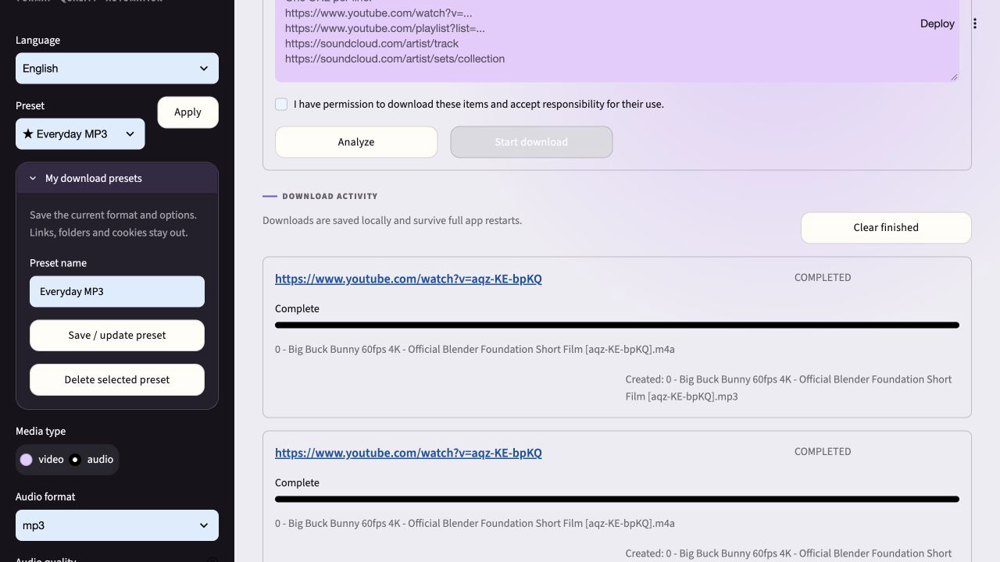
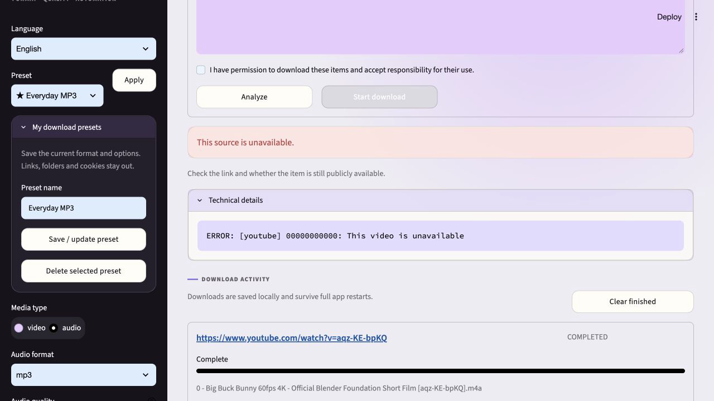
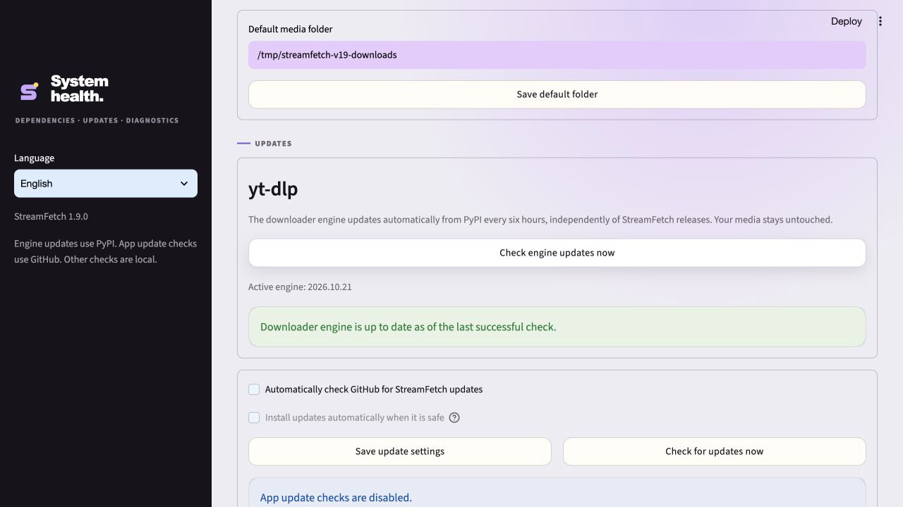

# StreamFetch 1.9.0 — Your presets. Clearer downloads.

_Released 2026-10-24 · Stable_

## In one sentence

Save your own download setups, get useful help when a source fails, and keep the
download engine current without waiting for a whole StreamFetch release.

## Visual tour

These are screenshots of the actual application on loopback with isolated state,
not mockups. The successful download uses Blender's **Big Buck Bunny**, published
under [CC BY 3.0](https://peach.blender.org/about/), from the
[official Blender upload](https://www.youtube.com/watch?v=aqz-KE-bpKQ).
Movie attribution: © 2008 Blender Foundation / www.bigbuckbunny.org.
The unavailable-source screenshot intentionally uses a nonexistent video ID.

## What changed

### Added

- **My download presets:** save up to 30 named setups, including format, quality,
  metadata, subtitles, collection limits and advanced options. Apply, update or
  delete them in the sidebar. Links, media paths and cookie-browser choices are
  deliberately excluded. Presets survive app restarts and join update backups.
- **Independent engine updates:** check stable yt-dlp releases on PyPI at startup
  and before downloads, with a six-hour cache and a manual System button. Download
  the engine, its declared matching EJS solver and CA certificate bundle into
  immutable app-state directories. Works without pip/admin rights in desktop builds.

### Improved

- Preserve yt-dlp's actual error when its API returns a nonzero exit code instead
  of replacing it with a generic failure. A bounded logger keeps the useful cause.
- Explain common access/login, unavailable-source, format, FFmpeg, storage,
  permissions, rate-limit, extraction and network errors with actionable guidance.
- Retry only recognised temporary job failures, with existing bounded backoff.
  Permanent/unknown failures stop for review; manual retry remains available.
  Source libraries can still perform their own internal request retries.
- Expand redacted technical details on demand. Clear previous source previews
  before a new analysis, so a failed link never shows the previous video's result.
- Correct bitrate conversion for yt-dlp's Python postprocessor API: strip the UI's
  K suffix. A real 192K MP3 download previously fell back to 128 kbit/s; the selected
  bitrate is now passed correctly. Existing audio files are not rewritten.
- Put personal preset management next to the preset selector and fix sidebar
  expander/button contrast, including the existing Advanced controls.
- Explicitly enable installed Node, Deno and QuickJS runtimes for previews and
  downloads. Bundle EJS resources explicitly and raise the release engine baseline
  to yt-dlp 2026.10.21. The UI version now follows the package version automatically.

## Upgrade notes

No media migration is needed. Presets live in `download-presets.json` inside the
app-state directory. Engine bundles live in `engines/`; failed checks or downloads
retain the existing engine and show a warning. Failed checks retry on later use
after 15 minutes. PyPI checks are independent of the GitHub app-update preference.

Updates activate before the engine is imported. If it is already loaded, a new
bundle is prepared for the next **complete app restart**, not just a page refresh.
This avoids swapping modules during downloads. Python/mandatory dependency changes
that are incompatible with the app require a StreamFetch update. Internet access
and a supported separately installed JavaScript runtime remain necessary for many
YouTube sources; keeping yt-dlp current cannot guarantee every source works.

Error classification is heuristic guidance, not proof of an upstream cause.
Authentication is never attempted automatically and no restriction is bypassed.
Review technical details before sharing them, even after common secrets are redacted.

## Verified with

- Local Python 3.12: **211 passed, one optional FFprobe integration skipped**;
  **81%** package coverage. Ruff and whitespace checks pass.

- Automated tests for preset persistence, sensitive-field exclusion, validation,
  limits, backup inclusion, classified failures, bounded original errors and retries.
- Engine tests cover hashes, unsafe archives, incompatible Python, cached/offline
  use, concurrent checks, corrupt state and restart-only activation.
- Actual browser interactions: save/apply a custom preset, reload across a complete
  server restart, complete a permitted YouTube MP3 download, reproduce an unavailable
  source and run the System engine check.
- Actual automatically updated engine: full Big Buck Bunny MP4 download and
  complete FFmpeg decode without errors. A real PyInstaller diagnostic executable
  independently loaded the updated engine and EJS resources outside its bundle.
- Actual packaged macOS backend: full MP4 download through the real browser UI;
  source UI: full MP3 download verified at 192,000 bit/s and decoded end to end.
- Python 3.11/3.12/3.13 CI and macOS/Windows/Linux desktop builds run for this release.
  Interactive Windows and physical-phone checks remain separate manual checks.

## Links

- [GitHub release](https://github.com/mxweir/streamfetch/releases/tag/v1.9.0)
- [Security and engine-update trust boundaries](../../SECURITY.md)
- [Official yt-dlp JavaScript setup](https://github.com/yt-dlp/yt-dlp/wiki/EJS)
