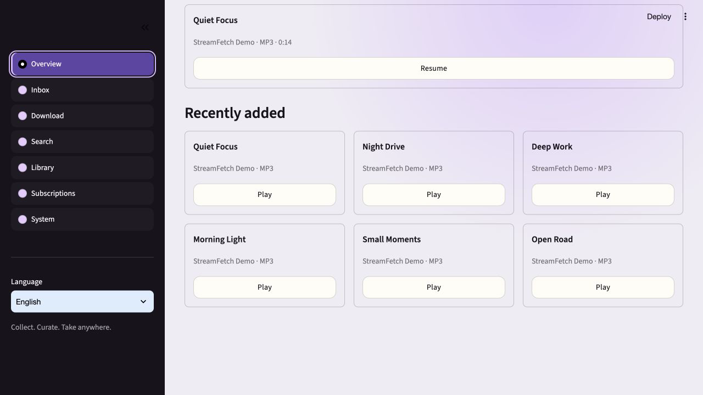
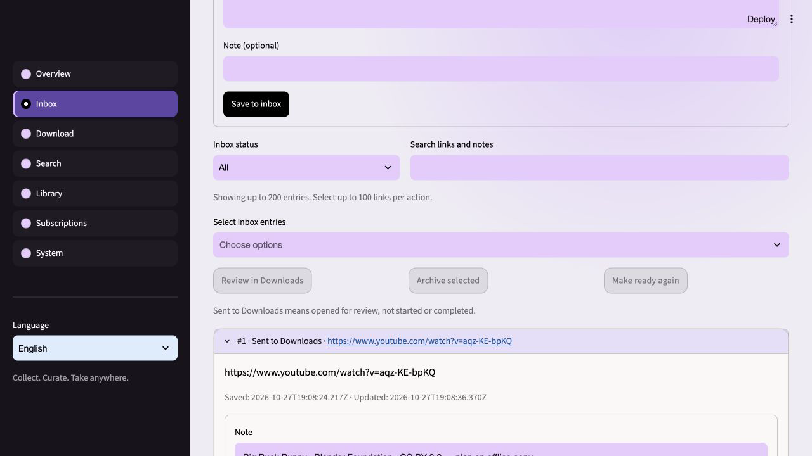
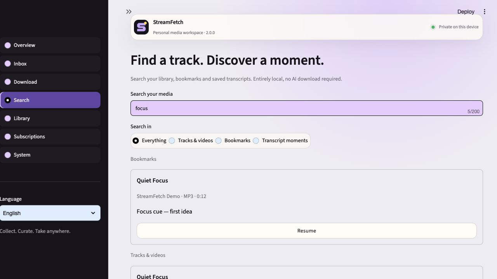
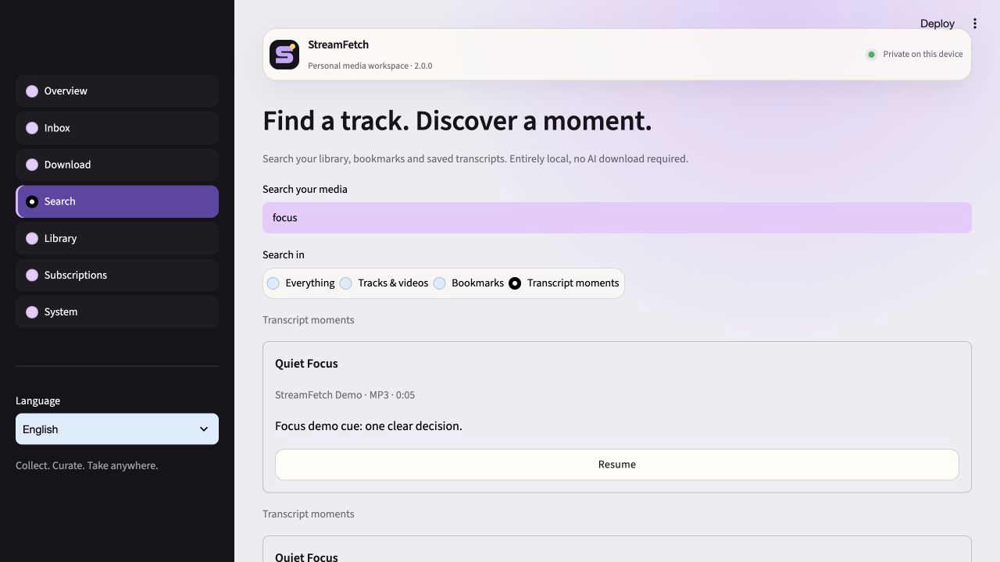
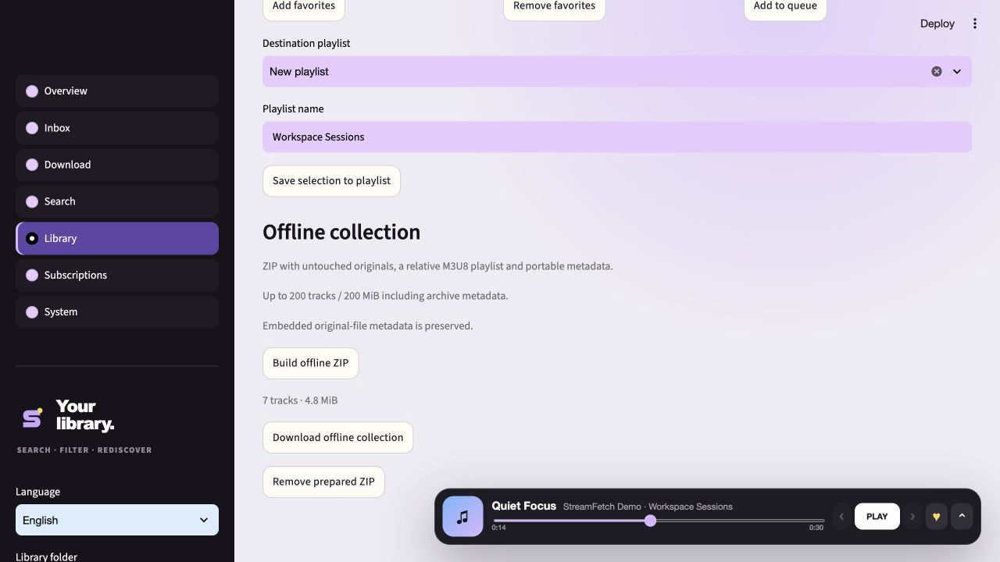

# StreamFetch 2.0.0 — Collect. Curate. Take anywhere.

_Released 2026-10-28 · Stable_

## In one sentence

A personal, local-first media workspace that connects saving a link, finding a
moment, organizing a collection and taking your original files with you.

## Visual tour

These images show the actual application, not design mockups. Media used for
demonstration is isolated from private libraries. See verification below for
the distinction between automated checks and interactive device testing.

## What changed

### Added

- **Link inbox:** persist supported YouTube and SoundCloud links without making
  a network request or starting a download. URL deduplication and ready,
  handed-off and archived states make saved links manageable across restarts.
  Hand-off prepares the download workflow; confirmation still belongs to you.
- **Unified local search:** find indexed media metadata, timestamped bookmarks
  and current transcript segments from one workspace. Open results in Library,
  including exact timestamp jumps for moments. No Whisper installation is needed
  for metadata, bookmarks or imported-subtitle search. Outdated transcripts are
  excluded rather than presented as current.
- **Bulk collection actions:** act on selected library tracks together: favorite,
  queue or add them to a playlist instead of repeating the same action per item.
- **Portable collection export:** download original files together in a ZIP with
  an M3U8 playlist using relative paths and a SHA-256 file manifest. Exports are
  capped at 200 tracks and a 200 MiB archive to bound memory and transfer size.
  Extract the archive and open the playlist in a compatible local media player.

### Improved

- Replace competing workspace controls with a compact app bar and a primary
  sidebar: Overview, Inbox, Download, Search, Library, Subscriptions and System.
- Give Overview a practical purpose with continue-listening shortcuts, recent
  media and download-job counts. The actual player remains in Library.
- Scope download archives to the selected output profile. A previous video
  download no longer incorrectly suppresses an audio or different-quality job.
- Distinguish output variants, including clips, in filenames so format choices
  can coexist instead of silently colliding.
- Associate completed files with the job that produced them, not a broad scan of
  recently changed files. Invalidate the library index once per completed batch.
- Retain independent verified yt-dlp engine updates, named presets, actionable
  errors and the rest of the 1.9 feature set.
- Detect the suggested home-network address without blocking hostname DNS;
  disconnected or unsuitable interfaces safely fall back to loopback.

## Upgrade notes

Keep the normal pre-update backup. Existing media is not renamed or rewritten.
Old output files remain usable, while newly produced variants use the revised
naming/archive rules. A historical archive alone is not proof that every output
profile already exists; review downloads when changing format or quality.

The inbox joins local app state and update backups. It may include private
SoundCloud share tokens: protect both state and backups, and do not publish them
as diagnostics. Saving a link offline does not establish rights or availability.

An exported collection is a portable copy, not a complete application backup or
a ZIP-import/restore format. Original embedded ID3 URLs, comments and other tags
are intentionally preserved. The generated manifest does not add absolute
database paths or app secrets, but it cannot remove information already present
inside original files. Review media before distributing it. Collection export
does not introduce a new home-player download API or bypass device permissions.

Continue-listening and timestamp actions open Library. Continuous cross-page
playback, synchronized multi-room audio, cloud accounts, offline web-app
installation and DRM circumvention are not part of 2.0. Existing encrypted home
sharing retains its opt-in permissions and one-time certificate setup.

## Verified with

- **Local suite:** 291 passed, 2 optional/platform-specific skips; 84% measured
  Python package coverage. Ruff and `git diff --check` passed. Tests include
  English/German full-app routing, export path/race defenses, pagination, offline
  inbox behavior, update backups and profile-specific download isolation.
- **Actual browser flows:** Overview resume, inbox capture and explicit review
  into the download editor, metadata/bookmark/transcript search, timestamp jumps
  into the real player, seven-track playlist creation and offline ZIP generation.
  ZIP CRC, all seven SHA-256 hashes and relative playlist paths were checked.
- **Live permitted download:** the official Blender Foundation
  [Big Buck Bunny](https://www.youtube.com/watch?v=aqz-KE-bpKQ)
  ([CC BY 3.0](https://peach.blender.org/about/), © 2008 Blender Foundation /
  www.bigbuckbunny.org) was downloaded as a 360p MP4 and then a 192-kbit/s MP3
  into the same output folder. Both complete 10:34 files decoded successfully
  with FFmpeg; the downloader reported only its own final media file per job.
- **Packaging/upgrade check:** a fresh Python 3.12 environment installed the
  project with current dependencies; the wheel and macOS ARM64 PyInstaller build
  succeeded. Its backend rendered the workspace, retained an inbox entry and
  played a timestamp result against a library seeded by the released 1.9 wheel.
- **Demo provenance:** screenshots use seven generated synthetic tones with
  explicit demo metadata and imported synthetic captions, not a claim of speech
  recognition on those tones. No private library or pairing credential is shown.
- **Platform boundaries:** CI covers Ubuntu Python 3.11–3.13 plus Windows and
  macOS Python 3.12, including the Windows opened-handle export check. Desktop
  artifacts are built by the release pipeline. Neither automated tests nor builds
  substitute for interactive Windows GUI or physical-phone testing; those remain
  unverified in this release's manual checks.

## Links

- [GitHub release](https://github.com/mxweir/streamfetch/releases/tag/v2.0.0)
- [Product scope and acceptance criteria](../V2_PRODUCT_BRIEF.md)
- [Full changelog](../../CHANGELOG.md)
- [Security and trust boundaries](../../SECURITY.md)
- [Previous visual release: 1.9](v1.9.0.md)
