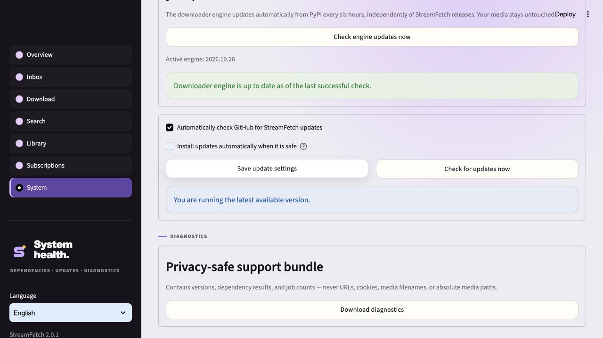

# StreamFetch 2.0.1 — Verified desktop updates

_Released 2026-10-28 · Maintenance update_

## In one sentence

Keep the complete 2.0 workspace, and make verified HTTPS update checks work in
desktop packages without depending on the build machine's certificate location.

## Visual tour

Captured from the freshly downloaded, unmodified macOS release package. Both
update checks succeeded with certificate and hostname verification enabled.
The interface and 2.0 features are unchanged.

## What changed

- Use the already packaged Mozilla CA bundle for PyPI engine checks/downloads,
  GitHub release checks and desktop update downloads.
- Preserve configured system trust, certificate validation and hostname checks.
  No insecure fallback, CA trust-store installation or certificate-warning bypass.
- Declare certifi directly as an application dependency.

The final downloaded 2.0 macOS artifact exposed a missing default CA path.
An isolated test reproduced the failing default HTTPS request and successful
certificate-verified request with the packaged CA bundle. The 2.0 release/tag
remains intact; 2.0.1 is the corrective follow-up.

## Upgrade notes

No data migration. Libraries, media, app state and private home TLS identities
are unchanged. If a 2.0 desktop update check cannot connect, download 2.0.1 from
GitHub manually. Do not disable TLS verification or change OS certificate trust.

## Verified with

- Final local suite: **294 passed, 2 optional/platform skips**, 84% package
  coverage; Ruff clean. All five release-candidate CI jobs passed.
- Regression tests exercise an empty system CA store and require hostname and
  certificate verification for all three update request paths.
- The full suite and five-platform/Python CI matrix gate publication.
- Release desktop artifacts are built separately for Windows, macOS and Linux.
- Interactive Windows GUI and physical-phone testing are not claimed.
- Downloaded the published macOS DMG, matched its SHA-256 to GitHub's digest,
  mounted it read-only and ran its backend against the retained demo library.
  Startup, forced PyPI engine check and GitHub app-release check passed without
  the 2.0 certificate warning. No diagnostic code was injected into 2.0.1.
- All three release desktop builds completed and their assets were uploaded.

## Links

- [GitHub release](https://github.com/mxweir/streamfetch/releases/tag/v2.0.1)
- [Five-platform/Python CI](https://github.com/mxweir/streamfetch/actions/runs/40648689494)
- [Desktop builds](https://github.com/mxweir/streamfetch/actions/runs/40649074062)
- [Full 2.0 visual tour](v2.0.0.md)
- [Security policy](../../SECURITY.md)
