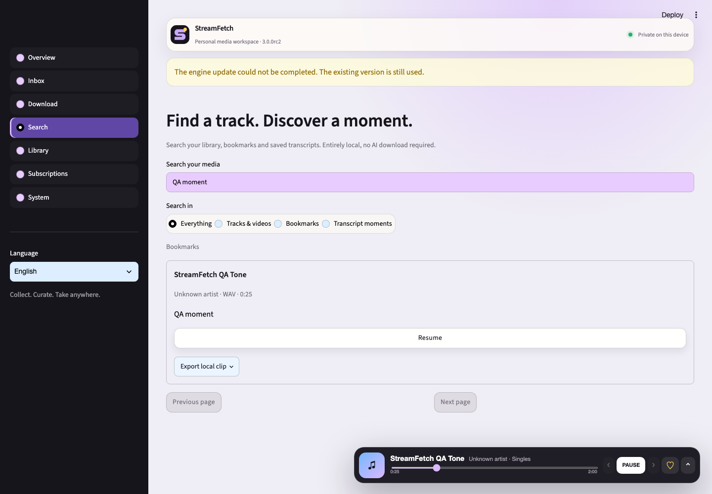
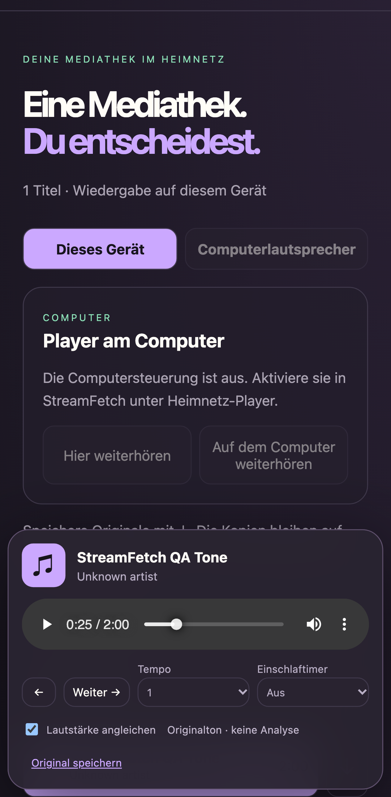

# StreamFetch 3.0.0 RC2

## In one sentence

Find a moment in your own media, keep it playing while you work and bring your library to a new folder with its listening history intact.

## Visual tour

## What changed

RC2 fixes media playback in the native desktop package when its server uses a private URL prefix.

- **Downloads.** One process writes the workspace’s download journal. Identical active requests reuse the existing job. Temporary files stay out of the media index. Completed jobs with a local result can open it in the library.
- **Library.** Missing files keep their stable IDs, favorites, bookmarks, playlists and listening positions. You can explicitly relink a moved file that has the same size, modification time and format.
- **Search and playback.** Search the active library and watched folders, or restrict results to a folder. Find a bookmark or transcript segment and seek there in the floating player. Export a local excerpt with FFmpeg.
- **Recovery.** System creates a checksummed folder backup of indexed libraries with optional originals. Preview and restore the backup to a new folder alongside the current library.
- **Home network.** English and German are selected from the device browser language. Pair over HTTPS using the existing one-use QR link. Play on the phone or save individual originals when the computer enables downloads.
- **Desktop updates.** Installer selection now includes OS and CPU architecture. StreamFetch verifies the SHA-256 digest before staging the installer. Desktop startup uses a private readiness route belonging to its own server process.

## Upgrade notes

Close older StreamFetch instances before opening the same workspace in the RC. Start with a copy of your existing library when evaluating the pre-release. Keep the previous installer and a separate backup if you need to roll back.

The library backup covers indexed media state and optional originals. Restored folders can be opened individually. Global inbox, settings, subscription definitions and download jobs are outside this backup format.

## Verified with

- Local synthetic search on an Apple M5 Pro, macOS 26.6.2, with 10,000 titles and 100,000 transcript segments. The warm p95 for the first page ranged from 1.4 to 62.2 ms across four sample queries.
- Chromium desktop navigation across all seven workspaces with active audio and a seek to a saved bookmark.
- FFmpeg-generated audio used for the interface screenshots and local clip. The 25–32.5 second selection produced a decodable AAC clip.
- Real downloads with yt-dlp 2026.10.26 produced a decodable 41,058,403-byte MP4 of [Big Buck Bunny by Blender](https://www.youtube.com/watch?v=YE7VzlLtp-4) and a decodable 2,587,601-byte MP3 of [Ouroboros by Kevin MacLeod](https://soundcloud.com/kevin-9-1/ouroboros). Both examples are offered under Creative Commons Attribution.
- The emulated mobile Chromium viewport completed a one-use HTTPS pairing, played the test audio and downloaded the original byte for byte.
- The locally built Apple Silicon macOS package started its own server. Chromium opened the packaged app, found a bookmark and played media from the private server route.
- A library created with StreamFetch 2.0.1 kept its favorite, playlist, bookmark, transcript and playback position through RC2 migration.
- 298 automated tests passed, two skipped. Ruff and JavaScript syntax checks passed.
- The stable release gates remain open for physical iPhone and Android devices, interactive Windows, external pilot users and assistive technology. Offline playback inside the phone browser remains outside the RC. Full updater rollback and signed artifact verification are still open.

## Links

- [3.0 roadmap and acceptance criteria](../ROADMAP-3.0.md)
- [Latest stable release](https://github.com/mxweir/streamfetch/releases/latest)
